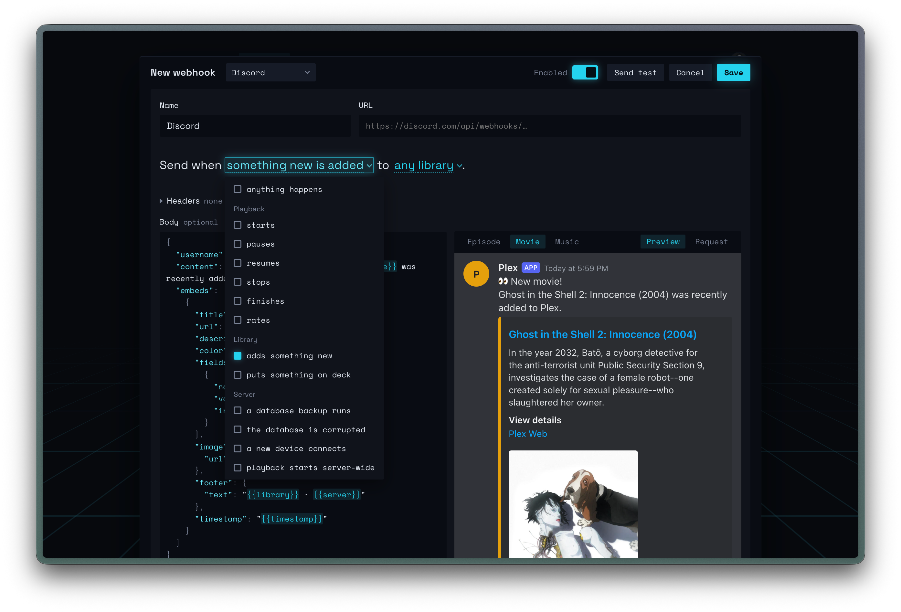

# mediahooks

Forward Plex Media Server webhooks to Discord, Slack, ntfy, Home Assistant or any URL.

- Pre-made templates for Discord, Slack, ntfy and Home Assistant
- Live previews and template variables
- See the last 100 events sent from Plex and whether they were delivered or not
- See the latest deliveries to each hook and their full request and payload



## Requirements

- Plex Media Server with Plex Pass on the owner's account 
- Docker, or [Bun](https://bun.sh) 1.4 or newer to run from source.

## Install

```yaml
# compose.yaml
services:
  mediahooks:
    image: ghcr.io/matthewlyle/mediahooks:1
    container_name: mediahooks
    restart: unless-stopped
    ports:
      - "8787:8787"
    extra_hosts:
      - host.docker.internal:host-gateway
    volumes:
      - mediahooks-data:/data

volumes:
  mediahooks-data:
```

```sh
docker compose up -d
```

mediahooks looks for Plex at `http://host.docker.internal:32400`, which is Plex running on the same
machine outside Docker (`extra_hosts` makes that name work on Linux). If Plex is somewhere else,
set `PLEX_URL` under `environment:`, e.g. `http://plex:32400` for a Plex container named `plex`.

The container runs as uid 1000. A bind-mounted `/data` folder must be writable by that user.

To run from source instead:

```sh
git clone https://github.com/matthewlyle/mediahooks.git && cd mediahooks
bun install
NODE_ENV=production bun run start
```

This looks for Plex at `http://localhost:32400`. Set `PLEX_URL` in the environment or a `.env`
file if it's elsewhere.

## Setup

Open `http://<host>:8787` and sign in with the Plex account that owns the server. Copy the
webhook URL from the Help page and add it in Plex Web under **Settings → Webhooks**.

## Configuration

| Variable | Default | |
|---|---|---|
| `PLEX_URL` | `http://host.docker.internal:32400` (`http://localhost:32400` from source) | Address of the Plex server |
| `PORT` | `8787` | |
| `PUBLIC_URL` | (unset) | Base address for `{{thumb_url}}` poster links |

Poster links only load where `PUBLIC_URL` is reachable. If you make mediahooks reachable from the
internet for that, expose only `/thumbs/*`.

## Upgrading

```sh
docker compose pull && docker compose up -d
```
